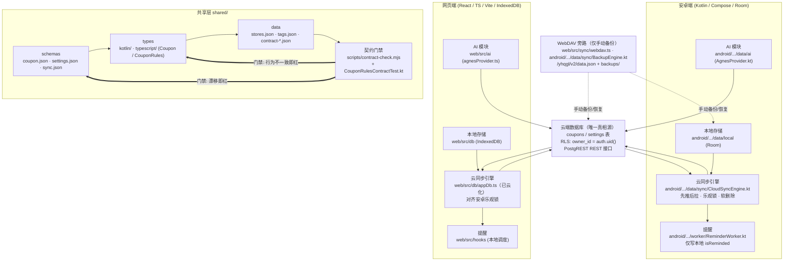
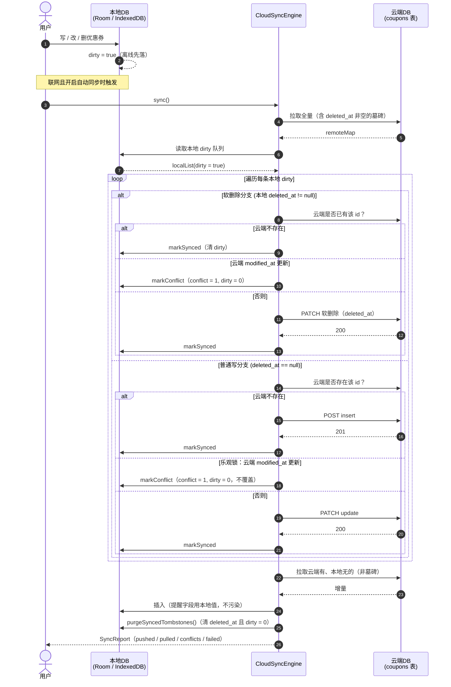
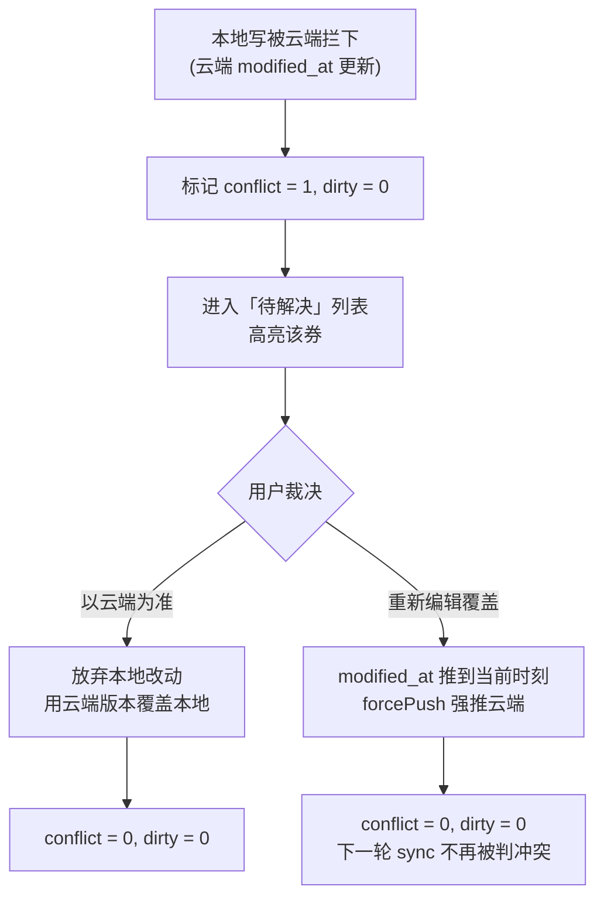
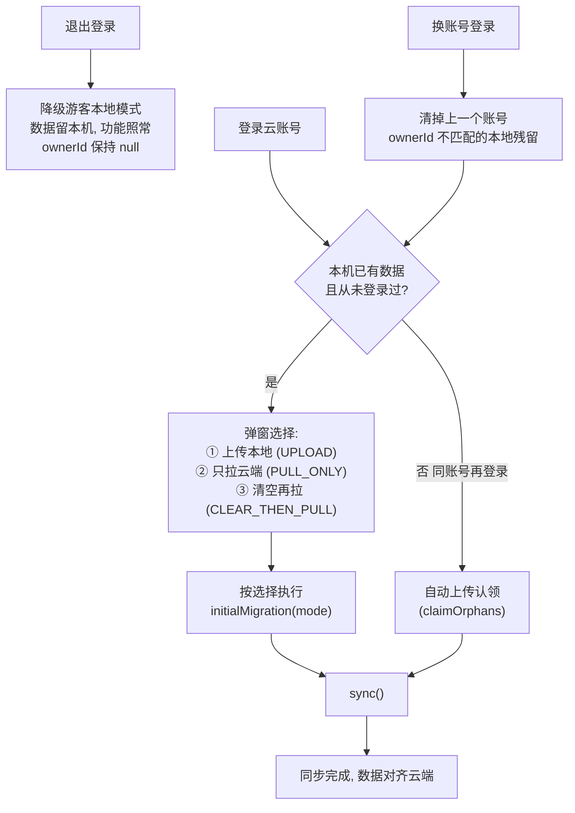

# clq-yhqgl 架构（v3，2026-10-26 定稿）

> 本文档是项目当前架构的**唯一事实来源**。旧方案 `docs/REFACTOR_ANALYSIS.md`（WebDAV 同步中枢 + 版本向量 + 字段级合并）已废弃，仅保留作历史参考；其提到的「版本向量 + 字段级合并」同步在实测中因网页端未参与协议、导致两份互不可见的数据，已被 v3 服务端权威模型取代。

## 1. 总体定位

以**云端数据库为唯一真相源**、双端**离线优先**、**共享业务规则层强制对齐**的优惠券管理双端应用。
同步采用「服务端权威 + 乐观锁」，WebDAV 仅作**可选手动备份**。

- 安卓原生 App：Kotlin + Jetpack Compose + Room + WorkManager + Hilt（DI）
- 电脑网页端：React + TypeScript + Vite + Tailwind + IndexedDB
- 后端：WorkBuddy 云服务（PostgREST 风格 REST + RLS 行级权限），无自建后端

## 2. 架构图

## 3. 同步时序（乐观锁 + 软删除）

## 4. 冲突处理

## 5. 游客 ↔ 登录切换

## 6. 关键约定

- **真相源**：云端 `coupons` / `settings` 表，RLS 按 `owner_id = auth.uid()` 隔离。
- **乐观锁**：写前比 `modified_at`，云端更新则整条拦下进「待解决」，不做字段级合并。
- **软删除**：`deleted_at` 非空即删除，唯一判定。
- **离线优先**：写先落本地（Room/IndexedDB）打 `dirty`，联网后 `CloudSyncEngine` 先推后拉。
- **提醒按设备各算**：`is_reminded`/`reminded_days` 仅本地，不同步（电脑提醒过手机仍提醒是预期行为，非 bug）。
- **业务规则**：TS 与 Kotlin 各一份，由 `scripts/contract-check.mjs` + `CouponRulesContractTest` 强制对齐。
- **数值与时区**：剩余天数**地板除法**（JS `Math.floor` / Kotlin `floorDiv`）；北京时区解释所有日期（endDate+endHour:endMinute:59）。

## 7. 任务分配

模块 owner、阶段里程碑（Phase 1-5）、18 个可执行 Issue 与协作分工，见 `docs/ARCHITECTURE_REPLAN.md`（本地工作区副本；仓库未含此文件时以 `docs/ARCHITECTURE.md` 为架构总纲、`shared/rules/*` 为协议细节）。
